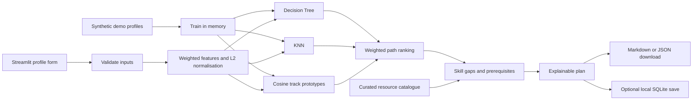

# Project guide and viva notes

Academic working title: **Student Skill Recommendation System Using Machine Learning**. UI title: **Student Skill Recommendation System**. The exact original synopsis title remains unverified because the referenced PDF was unavailable.

## Problem and objective

Students at different stages may know what interests them but struggle to choose a practical next skill. The application accepts educational background, current skills, interests and career goals, then suggests learning paths, missing skills and resources. It supports Class 10, Class 12, Diploma, Undergraduate and Graduate, including students who have not chosen a stream.

The current project demonstrates an end-to-end recommendation workflow. It does not determine a student's best career, admission eligibility, qualification equivalence or future income.

## Architecture

## Follow the code

1. Read `catalog.py`: the supported options and seven example learning paths.
2. Read `profiles.py`: input checks and conversion into a dictionary of numeric features. A value such as `interest:Coding = 1.0` means that interest was selected.
3. Read `engine.py`: `DictVectorizer` creates a feature matrix. Normalisation makes vector lengths comparable. The tree and KNN learn labelled example patterns. Each track's mean vector is its cosine prototype.
4. `score()` aligns the same sorted classes for all three methods and combines their scores.
5. `recommend()` subtracts existing skills and checks prerequisites. For example, Pandas is a later skill until Python is listed. A student can unlock it by learning Python and updating their profile.
6. Read `app.py`: inputs, results, course links, downloads, model lab and save actions.
7. Read `evaluation.py`: fitting a separate model on the training split prevents the test profiles from becoming their own KNN neighbours.

## Formula

Cosine similarity of feature vectors `a` and `b` is their dot product divided by the product of their lengths. It compares direction, allowing two profiles to match even if they list different numbers of skills.

The hybrid rank score is `0.35 × P_tree + 0.35 × P_knn + 0.30 × C_normalised`. Tree/KNN outputs are class scores from the synthetic examples. This weighted score is **not a calibrated probability**. Multiplying it by 100 would not turn it into accuracy or employability percentage.

## Database

One `plans` table: `id TEXT PRIMARY KEY`, `session_id TEXT`, `created_at TEXT`, `payload TEXT`. `payload` is a JSON result containing the profile, paths, missing skills, courses and caveats. Save/list/delete use SQL parameters, not string concatenation. SQLite is built into Python; no extra installation is required. It is not a source of training data.

## Two-minute demonstration

1. Open Discover your path and load the sample Class 12 profile.
2. Generate results. Explain Software Development as an example path; point out missing skills and a resource.
3. Switch to Data and Mathematics interests with a data analyst goal. Show how the result changes.
4. Add Python and Statistics basics to current skills. Generate again: Python is not suggested again and Pandas becomes available.
5. Change education to Diploma or Graduate. The same workflow remains usable.
6. Save a plan, view it in Saved plans, then download it.
7. Open Model lab and explain that the measured scores concern **synthetic labels only**.

## Common viva questions

**Why three algorithms?** A tree demonstrates rule-based classification learned from data, KNN demonstrates similarity to labelled examples, and cosine compares profile content to track prototypes. The hybrid combines their rankings. The current experiment does not prove an advantage over KNN alone.

**What is the dataset?** 420 fictional examples generated with a fixed seed, labelled by their intended topic. No real student survey or placement dataset is claimed.

**What was the measured accuracy?** Read the generated report. The current fixed synthetic holdout gives 97.14% hybrid agreement with synthetic labels and 53.33% for the shallow tree. That does not establish real-world recommendation accuracy.

**Why might the tree score be lower?** It has limited depth and must learn seven categories from multiple sparse, overlapping features. Inspect the per-class report rather than assuming every method performs equally.

**How are courses recommended?** Through human-written mappings from ready missing skills to resources. Classification metrics do not validate these mappings. Some links lead to course catalogues and are labelled as discovery resources.

**Does education decide the career?** No. It is a weak context feature. Every path is available at every level, while skill prerequisites determine what can be suggested immediately. This does not validate readiness for formal qualifications.

**Why not use only a rule system?** A rule-only baseline would be useful future work. Here the supervised algorithms demonstrate the requested academic methods, while transparent rules handle the skill gap. With synthetic data, the generator's patterns limit the research conclusions.

**What needs improvement?** Independent expert-labelled real profiles, consent and privacy controls, wider paths, current course metadata, multilingual goals, relevance/user studies, uncertainty estimates and fairness analysis.

## Hinglish explanation

“Is project mein student apni education, stream, current skills, interests aur career goal enter karta hai. Decision Tree aur KNN us profile ke liye learning path predict karte hain. Cosine Similarity profile ka match compare karti hai. Phir system jo skills pehle se aati hain unhe hata kar missing skills aur learning resources dikhata hai. Abhi dataset synthetic hai, isliye demo evaluation ko real students ki guaranteed accuracy nahi bolte.”

## Safe edits for a student

Add an interest to a track in `catalog.py`, then regenerate data and evaluation. Change a course title/link/mapped skills in `courses.json` without changing model code. Change colours and spacing in `assets/style.css`. Add a new prerequisite in `catalog.py`, then test beginner and experienced profiles. Adding a completely new track also needs synthetic examples, resources and evaluation review. Keep configuration choices documented.
